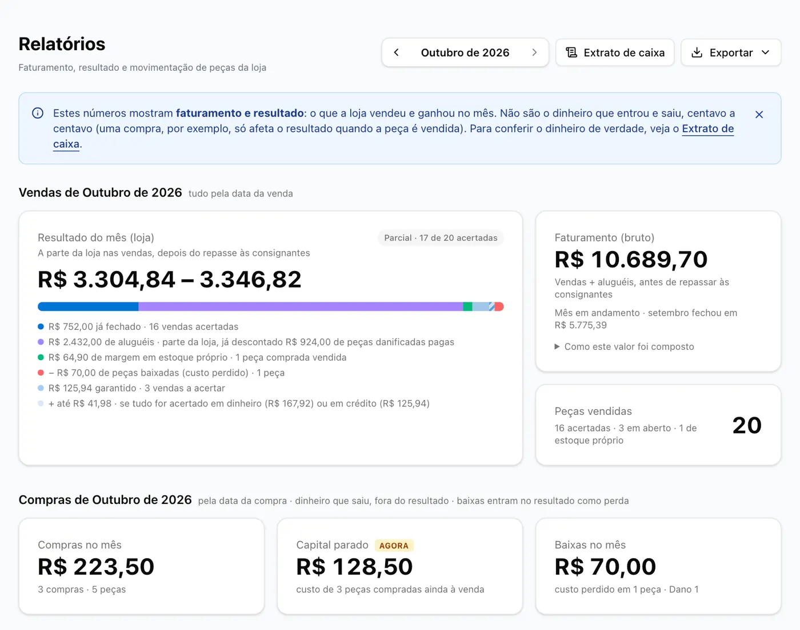
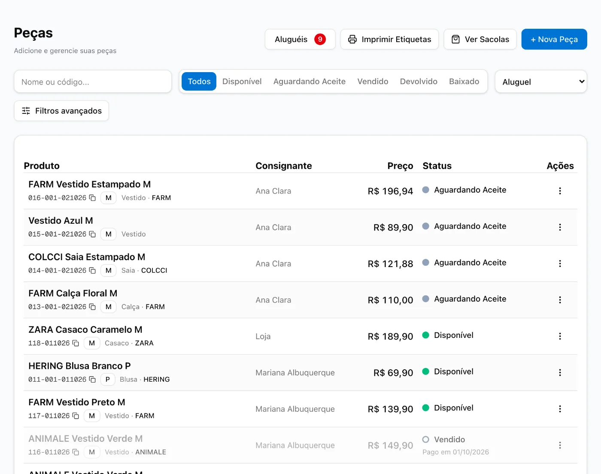
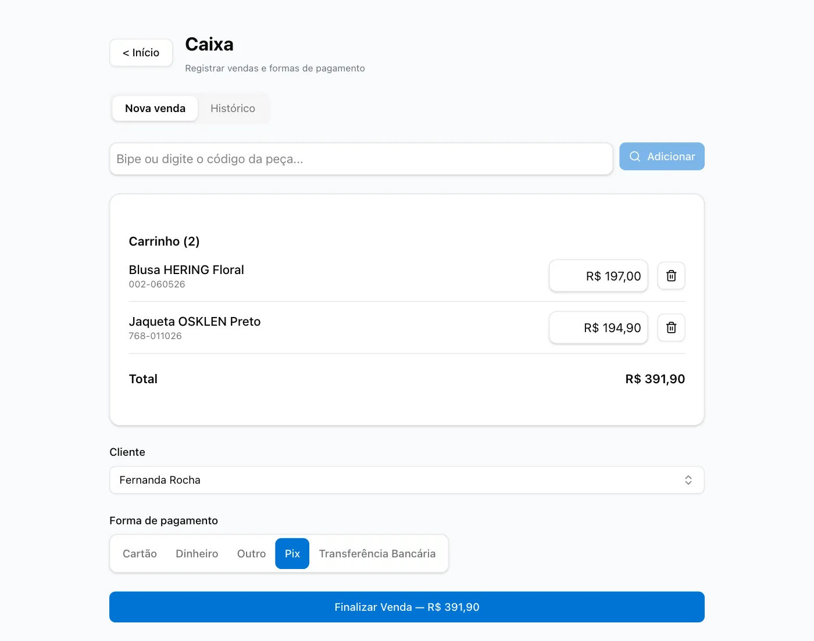
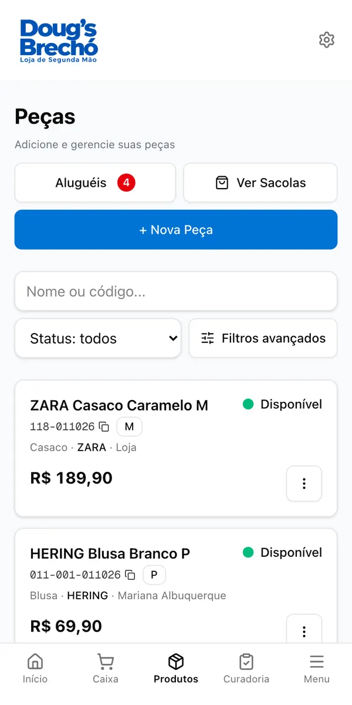
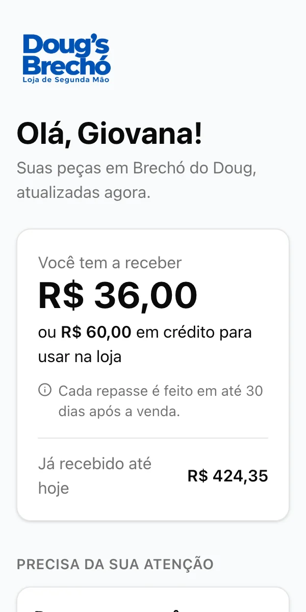

## Hi, I'm Douglas 👋

Full-stack developer from Joinville, Brazil. These days I'm building **Brechó**, a SaaS for second-hand and consignment stores, which I created and run as CTO.

Consignment stores take clothes from people, sell them, and pay each person their share later. Most of them still track this on paper or in spreadsheets. Brechó handles the whole thing: registering pieces and printing labels, the checkout, rentals, paying out consignors, monthly reports, and a page where each consignor can check her own pieces from the phone.

The code is private (it's a paid product), but here's what it looks like. The app is in Portuguese since the stores are in Brazil, and everything below is test data.

**Monthly report**: what the store actually earned after consignor payouts

**Inventory**: every piece, who brought it in, and where it is in its lifecycle

**Checkout**: scan the label, pick the payment method, done

**On the phone**: staff use it at the counter, and consignors get their own link with what they're owed

  
  &nbsp;&nbsp;
  

**Built with** Next.js, React, TypeScript, Supabase (Postgres), Tailwind CSS and Vercel.

### Contact

[LinkedIn](https://www.linkedin.com/in/cidraldouglas2000)
